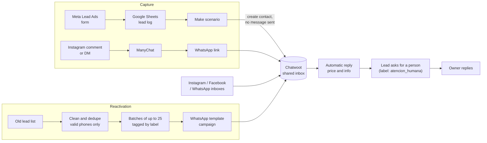

# Virtual Golf: lead capture, shared inbox and WhatsApp reactivation

**Client:** Virtual Golf (golf simulator company, Buenos Aires) [pending client approval]

One-line summary: I set up a shared inbox and a set of small automations so that every lead from Meta ads, Instagram and WhatsApp lands in one place, and I ran a batched WhatsApp campaign to re-open conversations with old leads nobody had followed up.

---

## The problem

Virtual Golf sells and installs golf simulators. Leads came in from three places: Meta lead forms, Instagram DMs and comments, and WhatsApp. Each one lived in its own app.

- Form leads sat in a spreadsheet export that nobody checked on a schedule.
- Instagram and WhatsApp conversations were answered from the phone, with no record of who had asked what.
- Hundreds of older leads who had asked about simulators had never received a second message.

The system had to run without the owner managing it day to day.

## What I built

**1. One inbox.** Chatwoot Cloud with WhatsApp, Instagram and Facebook connected. Conversations are labelled by source (Instagram, WhatsApp, Facebook) and by stage (new inquiry, automatic price reply sent, needs a human). Reactivation contacts carry a label per batch, and anyone who should never be messaged again carries an exclusion label.

**2. Meta form leads into the CRM.** A Make scenario checks the lead sheet every 15 minutes, applies a filter, and creates the contact in Chatwoot through its API, using the Meta lead ID as identifier. It does not send a message. If the lead writes in, they get the automatic first reply; the owner only steps in if they ask for a person.

**3. Instagram to WhatsApp.** ManyChat answers comments and DMs and hands the person a WhatsApp link, so the sales conversation happens in the channel the team actually uses.

**4. Reactivation of old leads.** Older leads who had asked about simulators got a WhatsApp template message, sent in small batches through Chatwoot campaigns. The message had a concrete reason to write: a simulator installation that had just been finished in Palermo.

## Key decisions and why

- **Chatwoot Cloud, not self-hosted.** The client pays for one seat and nobody has to run a server. For a small business with no IT person, a managed plan is cheaper than the hours spent keeping an instance alive.
- **Batches of up to 25.** Small batches protect the WhatsApp number's quality rating, keep replies at a volume one person can answer the same day, and let me adjust the message between batches.
- **Clean the list before anything is sent.** Empty, invalid and duplicate phone numbers are removed. Old reactivation leads and new ad leads stay in separate lists so a new lead never gets a "we haven't talked in a while" message.
- **Opt-outs are permanent.** The reactivation message tells people to reply if they'd rather not hear from us again. Anyone who says no, or who turns out to be a personal contact rather than a lead, gets an exclusion label and is filtered out of every future audience.
- **Automation first, owner when it matters.** First replies are automatic: price and basic info are sent right away. If the lead asks to talk to someone, the conversation is tagged for human attention and the owner picks it up. He only steps in when a lead is ready for a real conversation.

## Results

Data from Chatwoot and the lead sheet as of 23 Nov 2026.

| What | Number |
| --- | --- |
| Old leads reached by the reactivation campaign | 264 contacts |
| Replied (excluding people already in an active chat) | 34 (12.9%) |
| Asked for price, space requirements or details | 20 (7.6%) |
| Polite "no, thanks" | 2 |
| Automatic replies from other businesses | 3 |
| Batches sent (26 Oct – 20 Nov) | 14, with 273 messages in total |
| Sales or bookings recorded in the CRM | Not recorded yet |
| Conversations in the shared inbox since 5 Oct 2026 | 1,039 |
| Meta form leads logged in the sheet (30 Oct – 23 Nov) | 127 |
| Form leads that reached Chatwoot since the scenario went live (12 – 23 Nov) | 65 of 70 |

5 form leads did not reach Chatwoot. Two had an invalid or already-existing phone number, which the Chatwoot API most likely rejected without Make flagging the run as an error. The cause of the other three is still under review.

Time saved, estimated: creating 65 contacts by hand at about 3 minutes each (copy from the sheet, format the phone, add labels) would be roughly 3 hours. Sending 273 WhatsApp messages one by one at about 1.5 minutes each would be roughly 7 hours. These are assumptions, not measurements.

## My role

I worked directly with the owner and did the project end to end:

- **Discovery:** mapped where leads came from and what happened to each one (usually nothing).
- **Design:** decided the inbox structure, labels, list rules and batch size.
- **Build:** Chatwoot setup, Make scenario, ManyChat flow, list cleaning and campaign audiences.
- **Run and maintain:** I send the reactivation batches, add exclusions and keep the integrations working as a monthly service.

**Tools:** Chatwoot, Make, Google Sheets, Meta Lead Ads, ManyChat, WhatsApp Business API templates, and an AI coding assistant to write and review the list-cleaning and batch-selection logic.

## What I'd improve next

- **Catch silent failures.** Add error handling on the Chatwoot API step and a daily check that compares the sheet with Chatwoot, so a rejected lead is flagged instead of lost.
- **Close the loop on outcomes.** The labels for "showroom visit" and "sale closed" exist but are not used yet. Without them, the case stops at "interested". Next step is a weekly check-in with the owner to tag outcomes.
- **Enforce "never twice" at send time.** Nine contacts ended up in two different batches. The rule was applied when building lists, not when sending. A final check against everyone already contacted would make it airtight.
- **Classify replies automatically.** Right now I read replies to sort interest, no-interest and auto-replies. A simple classifier could pre-tag them for the team.
- **Measure response time.** Chatwoot already stores first-reply time. Reporting it monthly would show whether faster answers lead to more visits.
